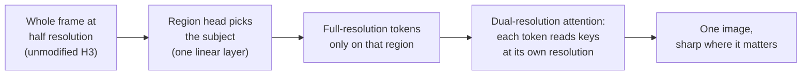

# mpeg-diffusion

**Spend full-resolution tokens only where they matter.** Mixed-resolution generation for the MiniMax H3 video DiT.

### 👉 Read the write-up: **[scrya.com/mpeg_diffusion](https://scrya.com/mpeg_diffusion)**

[Write-up](https://scrya.com/mpeg_diffusion) · [Weights](https://huggingface.co/johndpope/MiniMax-H3-MPEG-Diffusion) · [Caption embeddings](https://huggingface.co/datasets/johndpope/MiniMax-H3-pexels-people-text) · [Help train it (#2)](https://github.com/scrya-com/mpeg-diffusion/issues/2) · [Large images (#3)](https://github.com/scrya-com/mpeg-diffusion/issues/3) · [Discussion](https://github.com/scrya-com/mpeg-diffusion/discussions/1)

> [!WARNING]
> **Research code. It needs training.** Nothing here is a finished model yet. If you have GPU time, see [issue #2](https://github.com/scrya-com/mpeg-diffusion/issues/2).

---

## The idea



A face needs detail and a plain wall doesn't, but a diffusion transformer pays the same for every token. This repository ports two papers that fix that to MiniMax H3:

- **MPEG-Diffusion**: a complete half-resolution track, plus full-resolution tokens on a region the model selects itself. By Dennis Menn, Tianpei Gu, Guande He, Aryan V S, Yanke Song, Nan Liu, Desai Xie, Xun Huang, Chenfeng Xu and Diana Marculescu (UT Austin and Roblox), [arXiv 2611.12069](https://arxiv.org/abs/2611.12069).
- **Level-of-Token Diffusion**: bigger tokens where there is little detail. By Kiyohiro Nakayama, Brian Chao, Jan Ackermann, Hansheng Chen, Federico Tombari, Leonidas Guibas, Lior Yariv and Gordon Wetzstein (Stanford and Google), [arXiv 2610.05816](https://arxiv.org/abs/2610.05816).

These are independent ports. They are not the authors' releases.

## Where it is

| Piece | Status |
|---|---|
| Two-track sampler (`lot/two_track_h3.py`) | ✅ Works untrained: coherent 1344×768 stills at 281–322 tokens per step, against 1,008 at full resolution |
| Region head (`train_tt.py region`) | 🔄 Training on the frozen model with caption-guided subject masks ([how it works](docs/REGION_HEAD.md)) |
| Fine-tune so faces get redrawn (`train_tt.py lora`) | ⚠️ The 500-step LoRA changes the whole picture (washed out); not needed for the quality recipe |
| Wall-time speedup | ✅ Video at 1344×768 on an RTX 5090: 22 frames **1.94×** (14.0 s against 27.2 s), 73 frames **2.4–2.8×** (48–54 s against 130–135 s). Grows with clip length. Stills: no gain |
| Quality recipe | ✅ Fitted K/V maps (`fit-kv`, no DiT training) + region head v3: sharp subjects, no seams. `render --preset quality --frames 22` ([TWO_TRACK_FLOW.md](docs/TWO_TRACK_FLOW.md)) |
| More than two levels for many-megapixel images | 📝 Draft, CPU-tested ([LARGE_IMAGES.md](docs/LARGE_IMAGES.md), [#3](https://github.com/scrya-com/mpeg-diffusion/issues/3)) |
| Level-of-Token adapters | ⚠️ 2.15–2.85× faster DiT forward, but soft coarse regions ([LEVEL_OF_TOKEN.md](docs/LEVEL_OF_TOKEN.md)) |

## Performance (early measurements)

> [!NOTE]
> **Early measurements, not a benchmark.**
> - **Coverage:** one RTX 5090 and one int8 H3 checkpoint, 1–2 prompts per row, quality judged by eye.
> - **Region size:** two-track time depends on how much of the frame the region head picks (12–29% so far).
> - **Not yet tested:** other GPUs, resolutions, step counts, prompts and LoRAs.

All rows: 1344×768, wall time **including the VAE decode**, fitted K/V maps plus region head v3
([`--preset quality`](docs/TWO_TRACK_FLOW.md)).

**ComfyUI, 73 frames (3 s)**, int8 convrot VAE, warm runs:

| | Time | vs base full res |
|---|---|---|
| Base, full resolution, 20 steps | 132.4 s | 1× |
| Base + two-track, 20 steps | 68.3 s | 1.94× |
| Turbo LoRA, full resolution, 8 steps | 66.6 s | 1.99× |
| **Turbo LoRA + two-track, 8 steps** | **45.2 s** | **2.93×** |

**Longer clips, base model, 20 steps** (`two_track_h3.py render`). The gain grows with length:

| Frames | Full res | Two-track | Speedup |
|---|---|---|---|
| 22 (~1 s) | 27.1 s | 14.4 s | 1.9× |
| 73 (3 s) | 138 s | 56 s | 2.5× |
| 145 (6 s) | 398 s | 128 s | 3.1× |

A 15 s clip (362 frames) renders in ComfyUI with Turbo + two-track (250 s, cold start).

**Quality notes:**
- Subjects in the region are sharp, with no seams or flicker.
- Outside the region the frame is the half-resolution track, upscaled.
- Full res and two-track compose different pictures from the same seed.
- The base model needs no fine-tune; the Turbo LoRA works with the same maps.

## Quick start

```bash
git clone https://github.com/scrya-com/mpeg-diffusion && cd mpeg-diffusion
pip install -r requirements.txt                    # install torch for your CUDA first
python3 lot/test_lot.py                            # CPU, no weights -> ok 33

hf download Comfy-Org/MiniMax-H3 \
  diffusion_models/minimax_h3_fl2va_pruned_int8_convrot.safetensors \
  vae/minimax_h3_video_vae_fp16.safetensors --local-dir models
export LOT_H3_CHECKPOINT=$PWD/models/diffusion_models/minimax_h3_fl2va_pruned_int8_convrot.safetensors
export LOT_H3_VAE=$PWD/models/vae/minimax_h3_video_vae_fp16.safetensors

# Two-track render: full res | half res | two-track, with the full-resolution region outlined
python3 lot/two_track_h3.py fit-kv --out runs/tt --items 24
python3 lot/two_track_h3.py render --out runs/tt/render --maps runs/tt/up_maps_tt.pt --box 0.3 0.15 0.7 0.9 --outline
```

To train everything (data, pairs, maps, LoRA, region head, decoder) with one command, see [`lot/CHEATSHEET.md` section 7](lot/CHEATSHEET.md#7-two-track-mixed-resolution-the-papers-own-arrangement-train-it). `--swap auto` picks how many blocks to stream from CPU for your card.

## Docs

| | |
|---|---|
| 📄 [docs/MPEG_DIFFUSION.md](docs/MPEG_DIFFUSION.md) | The paper's sampler, how this port matches it, and where it differs |
| 🎯 [docs/REGION_HEAD.md](docs/REGION_HEAD.md) | How the region head learns where the subject is (phase 1: features, phase 2: linear probe) |
| 🏋️ [docs/TRAINING.md](docs/TRAINING.md) | Guidance for the weak spots: maps, region and faces |
| 🖼️ [docs/LARGE_IMAGES.md](docs/LARGE_IMAGES.md) | Many-megapixel images with more than two levels (draft) |
| 🧱 [docs/LEVEL_OF_TOKEN.md](docs/LEVEL_OF_TOKEN.md) | The Level-of-Token port: timings, layouts, training |
| 🧾 [lot/CHEATSHEET.md](lot/CHEATSHEET.md) | Every command, step by step |

## What is here

| Path | What |
|---|---|
| [`lot/`](lot) | Method code, H3 glue, and scripts to cache data, train, render and time |
| [`third_party/musubi_tuner/`](third_party) | The subset of [kohya-ss/musubi-tuner](https://github.com/kohya-ss/musubi-tuner) that runs H3, unmodified (Apache-2.0) |
| [`comfyui/`](comfyui) | ComfyUI workflows for the LoT nodes in [ComfyUI-MiniMax-H3-Image-Lane](https://github.com/scrya-com/ComfyUI-MiniMax-H3-Image-Lane) |

All paths are environment variables listed in [`lot/lot_paths.py`](lot/lot_paths.py). This repository used to be called `lot-diffusion`, and GitHub redirects the old URLs.

## License

- Code in `lot/` and `comfyui/`: Apache-2.0 ([`LICENSE`](LICENSE)). `third_party/musubi_tuner/`: Apache-2.0 from musubi-tuner; see [`NOTICE`](NOTICE).
- MiniMax H3 weights and anything trained from them ([MiniMax-H3-MPEG-Diffusion](https://huggingface.co/johndpope/MiniMax-H3-MPEG-Diffusion), [MiniMax-H3-LoT](https://huggingface.co/johndpope/MiniMax-H3-LoT)) are under the [MiniMax H3 Community License](https://huggingface.co/MiniMaxAI/MiniMax-H3/blob/main/LICENSE): **not for use in the EU, UK, South Korea or USA**.

## Cite the papers, not this repository

- Dennis Menn, Tianpei Gu, Guande He, Aryan V S, Yanke Song, Nan Liu, Desai Xie, Xun Huang, Chenfeng Xu and Diana Marculescu, **MPEG-Diffusion: Mixed-Resolution Video Generation**, [arXiv 2611.12069](https://arxiv.org/abs/2611.12069).
- Kiyohiro Nakayama, Brian Chao, Jan Ackermann, Hansheng Chen, Federico Tombari, Leonidas Guibas, Lior Yariv and Gordon Wetzstein, **Level-of-Token Diffusion**, [arXiv 2610.05816](https://arxiv.org/abs/2610.05816).
