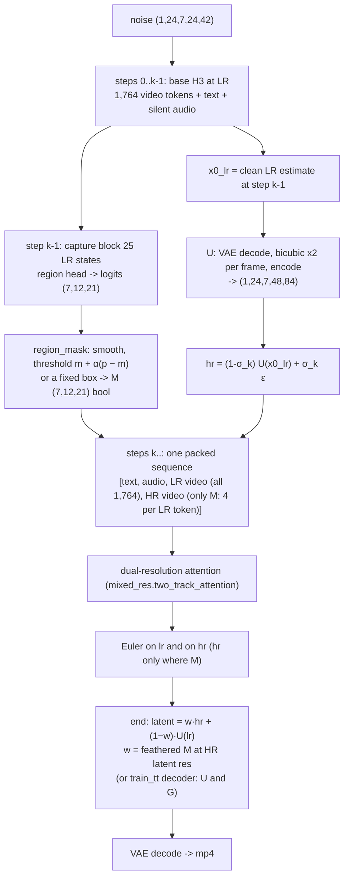

<!-- Built by: Claude Code (claude-opus-5-5), 2026-11-13. Written for a design cross-check. -->
# Two-track flow on H3: design, implementation, measurements

This document lays out the paper's design, this port's implementation, and measurements, so a reviewer can check
each step against the paper. Section 7 lists the questions where the port may deviate.

Paper: Dennis Menn, Tianpei Gu, Guande He, Aryan V S, Yanke Song, Nan Liu, Desai Xie, Xun Huang, Chenfeng Xu and
Diana Marculescu (UT Austin and Roblox), *MPEG-Diffusion: Mixed-Resolution Video Generation*, arXiv 2611.12069.
See [MPEG_DIFFUSION.md](MPEG_DIFFUSION.md) for the paper summary.

## 1. The paper's design

1. The first `k` of `T` steps denoise the whole video at low resolution (LR).
2. A linear region head `s = wᵀ LN(h)` on a middle block's LR states is smoothed and thresholded at
   `m + α(p − m)`. This gives the high-resolution (HR) region `M`, a set of space-time tokens.
3. The clean LR estimate is upscaled to HR and re-noised to the current sigma.
4. The remaining steps run both tracks in one sequence. The LR track covers the whole frame; the HR track covers
   only `M`. Attention is dual-resolution (their eq. 3):
   - each query reads keys and values at its own resolution;
   - missing keys and values come from linear maps `f_up` / `f_down`, applied before RoPE;
   - Prop. 1: a shared K/V is exact only when the merged tokens are identical.
5. A mixed-resolution decoder (`U` upsampler plus 3D-conv mixer `G`, their eqs. 5–6) merges the HR region with the
   upsampled LR frame.

Training: a full DiT fine-tune together with the K/V maps and learned LR/HR resolution embeddings (Wan2.1, 1,250
steps on 64 B200s). Each video is encoded at both resolutions and noised to the same level. Each latent is
supervised only on its own region (their eq. 2: LR outside `M`, HR inside `M`). `k` is 25 or 40 of 50 steps.
Reported: 4.8× on Wan 14B.

## 2. The port: one sampling run, with shapes for a 22-frame 1344×768 clip

H3 constants used below:
- VAE: ×16 spatial. 1, then 4, pixel frames per latent frame, so 22 pixel frames → `latent_t = 7`.
- Patch: 2×2, so one token covers 32 px at HR and 64 px at LR.
- Sigma schedule: shift 12.

| Quantity | HR (full) | LR (half) |
|---|---|---|
| Pixels | 1344×768 | 672×384 |
| Latent `(1, 24, T, h, w)` | `(1, 24, 7, 48, 84)` | `(1, 24, 7, 24, 42)` |
| Video tokens | 7 × 24 × 42 = **7,056** | 7 × 12 × 21 = **1,764** |



Code: `lot/two_track_h3.py`:
- `two_track_sample` runs the flow;
- `two_track_forward` runs one step;
- `VaeUpscaler` is `U`.

`lot/mixed_res.py` has:
- `TwoTrackPlan`, the index tensors for `M`;
- `two_track_attention`;
- `UpMaps` (`f_up`);
- `RegionHead`;
- `region_mask`.

### Attention, per block (`two_track_attention`)

- **Text, audio and LR queries** attend to text, audio and LR keys only. That part of the sequence is exactly the
  unmodified base model at LR, so no `f_down` is needed.
- **HR queries** attend to text and audio keys plus a full HR grid of keys and values (7,056 cells for the clip):
  - inside `M`: the HR tokens' own keys and values;
  - outside `M`: each LR token's pre-RoPE key and value expanded to its 2×2 cells by `f_up`. Without `--maps` it
    is a plain copy; otherwise `k + U Vᵀ k` (low rank), fitted by `fit-kv`.
  - The grid is roped at the HR grid's positions.
- **Positions:** H3's rotary positions are normalised by `sqrt(area)`, so the LR and HR grids share one coordinate
  frame.
- **Time:** T is a real dimension. `M` is `(T, h, w)`, and HR tokens exist per latent frame. HR queries see the
  whole clip's HR grid, every frame.

### Region (`region_mask`, `RegionHead`)

- The head reads block 25's LR video states at the switch step.
- Smoothing is spatial, per frame. The threshold `m + α(p − m)` is computed over the whole video (`temporal=True`).
- So far the head is trained on stills only. `docs/REGION_HEAD.md` covers it: caption-guided subject masks, and a
  linear probe on frozen features.

## 3. Training (`lot/train_tt.py`, `lot/build_pairs_tt.py`, one command: `lot/train_tt_all.sh`)

| Paper | Port |
|---|---|
| Full DiT fine-tune | LoRA rank 16 on qkv / out / fc1 / fc2 |
| K/V maps, trained | `UpMaps`, ridge-initialised by `fit-kv`, then trained with the LoRA |
| Resolution embedding | Two zero-initialised vectors (`ResolutionEmbedding`) added to LR / HR video rows |
| Eq. 2 loss | `eq2_loss`: LR loss outside `M` plus HR loss inside `M`, in H3's `x0 − eps` velocity |
| Pairs: video encoded at both resolutions | `build_pairs_tt.py`: `hr` = cached latent, `lr` = `U.down(hr)` (decode, area ×0.5, encode) |
| `M` from LLM + Grounded SAM | YuNet faces, YOLO / YOLOE people or caption-guided subject masks, on the LR token grid, else a random box |
| Decoder `U`, `G` | `train_tt.py decoder` (not yet trained) |

Status:
- **LoRA:** the first run (2,346 still pairs) stopped at step 500. Held-out loss was down 21% (LR) and 26% (HR).
  Render quality hasn't been evaluated.
- **Region head:** v3, trained on stills.
- **Clips (as of 2026-11-13):**
  - `build_pairs_tt.py` now accepts clips. It labels each latent frame on the last pixel frame it decodes to,
    giving masks `(T, h, w)`.
  - `train_tt.py` random boxes now span every frame.
  - No clip cache exists yet at 1344×768, so neither has been run on clips.

## 4. ComfyUI node (`ComfyUI-MiniMax-H3-Image-Lane/mpeg_nodes.py`)

The node does the same flow on Comfy's own H3 model; it doesn't import this repo.
- `_predict_lr` is the base forward, plus a hook that captures block 25.
- `_predict_pair` builds the packed sequence and runs `_two_track_attention`.
- `_vae_upscale` is `U`.
- `_paste` is the feathered merge.

Limits:
- no `f_up` maps, no LoRA, no trained decoder;
- text conditioning only, no reference or keyframe inputs.

Branch `feat/mpeg-video` (local) adds a `frames` input:
- the audio length is derived from the frame count;
- the mask is `(T, h, w)`;
- `U` and the paste work per frame;
- the region output is one image per latent frame.

That branch has a syntax check only; it hasn't been run inside ComfyUI.

## 5. Measurements (RTX 5090, 8 of 50 blocks streamed from CPU, 20 steps, untrained)

The test command:

```bash
python3 lot/two_track_h3.py render --out lot/runs/tt_video/f22 --cache <pexels cache> --prompts 2 --frames 22 \
    --steps 20 --switch 16 --hr-steps 6 --box 0.3 0.15 0.7 0.9 --outline --variants hr,lr,two_track
```

| Variant (22 frames, 1344×768) | Wall time | Mean video tokens / step |
|---|---|---|
| Full resolution | 45.9 s, 44.9 s | 7,056 |
| Half resolution, then VAE ×2 | 22.9 s, 23.1 s | 1,764 |
| Two-track, box 30% of frame, switch 16, 6 HR steps | 35.6 s, 36.0 s (**1.26×**) | 2,382 |
| Same, latent ×2 at the switch, 4 HR steps | 31.5 s, 30.4 s (1.45×) | 2,218 |

The meta.json files store a smaller mean token count for both two-track rows, from a counting bug (LR steps counted
for one frame, not seven) that is now fixed. The 2,382 and 2,218 in this table are worked out by hand.

The latent ×2 row is not usable: the region shows striping and ghosted faces. Its quality loss can come from the
latent ×2 switch or from having only 4 HR steps on the steep tail; that run changed both at once.

Per piece, 7 latent frames:

| Piece | Time |
|---|---|
| One full-res step (7,056 tokens) | 2.07 s |
| One LR step (1,764) | 0.73 s |
| One two-track step (1,764 LR + 2,268 HR) | 1.71 s |
| `U` round trip (decode, ×2, encode) | **5.29 s** |
| VAE decode, full res | 2.06 s |

So the default two-track run is about 16 × 0.73 + 2 × 5.29 + 6 × 1.71 ≈ 32 s, of which the two `U` calls are 33%.

Observations:
- Clips are coherent across frames. The composition comes from the LR track.
- Untrained, the HR box is grainy (see `lot/runs/tt_video/f22/grid.png` and the mp4s).
- A still gets no wall-time gain at all (17–21 s for every variant). Block streaming and fixed costs dominate there.

## 6. Where the time goes, and what would make it faster

1. **`U` at the end.** Replace the latent paste with a pixel-space composite: decode LR at half resolution (cheap),
   upscale the pixels, and paste under the decoded HR. This saves about 5 s and an encode. The trained `U`/`G`
   decoder is the paper's answer.
2. **`U` at the switch.** It is needed for quality on the evidence so far; the latent ×2 test is confounded with
   the shorter tail. A small learned latent upsampler (`mixed_res.LatentUpscaler`) would take milliseconds.
3. **HR query cost.** Each HR query attends to the full 7,056-key HR grid, so a 30% region costs about 30% of
   dense attention, plus the cost of building the grid and the gather. A smaller region helps: the trained head
   picks 12–28%.
4. **Fixed per-step cost.** The LR step is only 2.8× cheaper than full res for 4× fewer tokens, because of block
   streaming and per-step overhead. A card that holds all 50 blocks (48 GB or more) would widen the gap.
5. **Schedule.** The paper uses `k` = 40 of 50. With shift 12, few low-sigma steps remain after the switch, which
   is why there is `--hr-steps` (linear in sigma).

Projected, still untested: removing both `U` calls brings the run from 32 s to about 22 s against 45 s for full
resolution, so **about 2×**. With a 15–20% region and no block streaming, about 2.5–3×.

## 7. Questions for the cross-check

1. **LR queries attending only to LR keys.** Is that the paper's eq. 3? Or should LR queries also read HR keys
   inside `M` through `f_down`, so that the HR detail feeds back into the LR track?
2. **Region is chosen once.** `M` is selected once at the switch, over the whole clip, and the threshold is
   computed over the video. Does the paper select per frame, or once per video? Should `M` be allowed to move
   with the subject over time?
3. **Re-noising at the switch.** The port uses `(1 − σ_k) U(x0_lr) + σ_k ε` with fresh noise. Is that the paper's
   re-noise, or do they reuse the LR noise, upsampled?
4. **Clip pairs.** `lr = U.down(hr)` is decode, area ×0.5, encode for a clip. Is a temporal VAE round trip at half
   resolution an acceptable stand-in for encoding the video at both resolutions?
5. **Clip region labels.** Each latent frame is labelled on its last pixel frame. Should it be the union over the
   4 pixel frames it covers?
6. **LoRA instead of a full fine-tune.** Is rank 16 enough capacity for the HR track to redraw faces? The paper
   fine-tunes the whole DiT.
7. **Silent audio.** H3 is joint audio-video, and the port feeds silent audio noise at the matching sigma, with
   the same length for both tracks. Any interaction there?
8. **Timing method.** Wall time includes `U` and the text conditioning. Is a per-step token-compute comparison the
   fairer number to compare with the paper's 4.8×?
